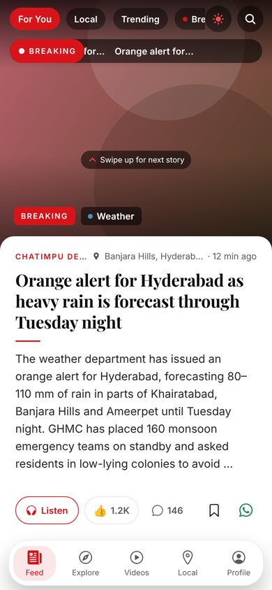
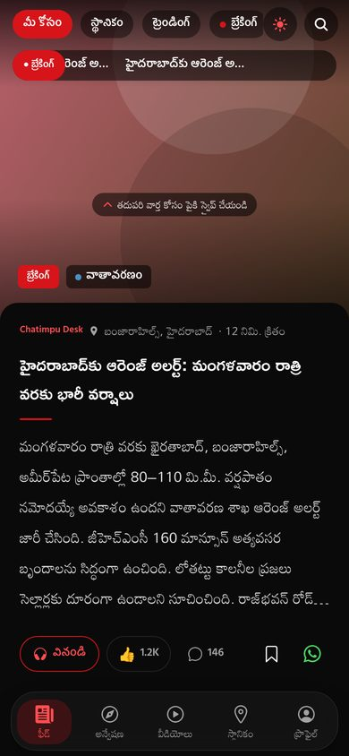
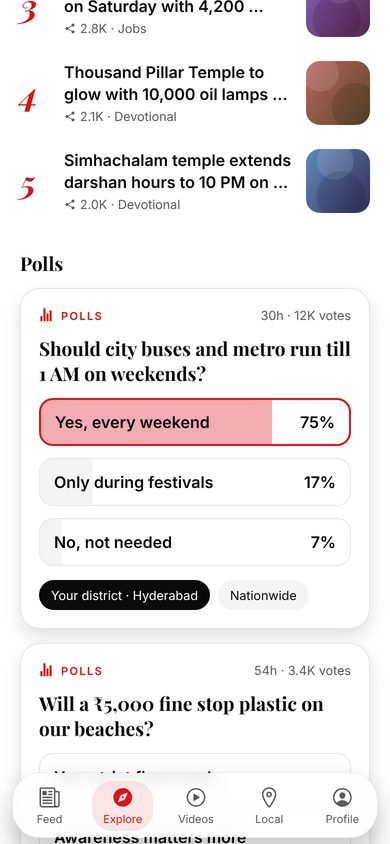
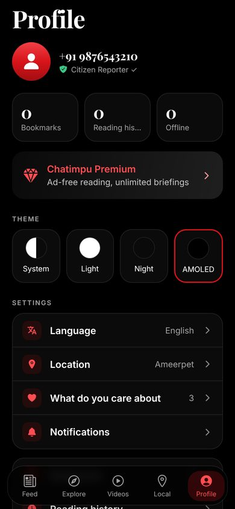
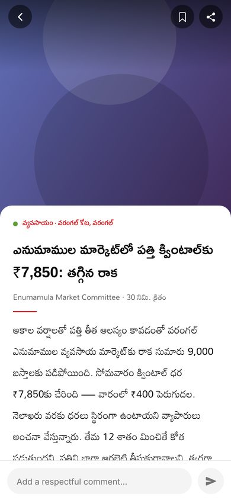
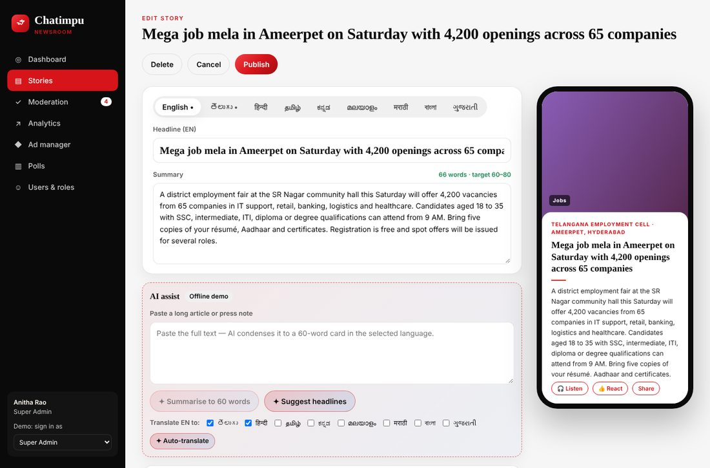

# Chatimpu — hyperlocal short news for India

A premium, editorial-grade short-news app: every story is a 60–80 word card you flip through
with a 3D page-flip, filtered down to your district, mandal and village, in 9 Indian languages.

> **Chatimpu — చాటింపు** is the drum-beat announcement that once carried news through Telugu
> towns and villages. Name, Telugu wordmark and domain live in `app/src/config.ts` (+ `name`/`slug` in `app/app.json`).

## Brand

**Logo.** The red drum-man emblem (the village *chatimpu* drum-beat announcement) with the bold navy
చాటింపు wordmark and www.chatimpu.com. The original artwork is used for the app icon, adaptive/monochrome
Android icons, splash, launch animation, share card, CMS and reporter portal (`app/assets/brand/emblem.png`,
`admin/public/chatimpu-emblem.png`).

**Colours — from the logo.** Emblem red `#ED1C24`, wordmark navy `#2E3192`, white, plus near-black
`#0A0A0A` for the Night/AMOLED reading themes. Buttons and small red text use `#D7141A` (white on it is 5.2:1)
and switch to `#FF4D52` on black (6.1:1); navy text on white is 10.7:1, so every combination meets WCAG AA.

**Telugu typography.** Chosen from the open-licensed (SIL OFL, free to embed in apps) Telugu faces
designed for news and screen reading:

| Role | Font | Why |
|---|---|---|
| Headlines, wordmark | **Ramabhadra Bold** | Ramabhadra is the popular Telugu headline face; it ships in one weight, so we build a real bold cut from it (`tools/make_ramabhadra_bold.py`, FreeType outline emboldening; OFL) — iOS does not fake bold for custom fonts |
| Story text | **Ramabhadra** (regular) | Same family as the headlines at normal weight, so cards read as one voice |
| Buttons, labels, tabs | **Hind Guntur** (500/600) | Indian Type Foundry UI family with real weights, so small Telugu UI text stays crisp |

Each Telugu role gets its own size and line-height correction (`app/src/theme/fonts.ts`): Ramabhadra is a
wide face with tall stacks (natural line height 1.9× its size), so headlines are set ~12% smaller and story
text ~8% smaller with ~1.8× leading; the feed card gives Indic summaries a little more room (photo 33% of the
screen instead of 40%) so a full summary fits. English uses Playfair Display + Inter. The CMS and reporter
portal use the same faces (the bold cut is served as Ramabhadra weight 700).

<p>




</p>
<p>




</p>



```
chatimpu/
├── app/        Mobile app — Expo SDK 58, React Native 0.88, Expo Router, Reanimated 4, Gesture Handler 3
├── admin/      Newsroom CMS — Vite + React 19 + TypeScript
├── supabase/   Postgres schema, RLS, RPC API, seed, Edge Functions (AI assist, push), search sync
└── docs/       API reference
```

The app and CMS share one source of truth for types and sample data: `app/src/data/`
(24 stories × English + Telugu across Hyderabad, Warangal and Visakhapatnam, plus polls, alerts,
magazines, ads, videos and citizen reports). The SQL seed is generated from the same files.

## Quick start (demo mode — no backend needed)

Requirements: Node 20+.

```bash
# Mobile app
cd app && npm install
npx expo start            # press a (Android), i (iOS) or w (web)
```

Most of the app runs in **Expo Go**; for haptics, share-as-image, notifications and video in
production, make a development build: `npx expo run:android` / `npx expo run:ios`, or
`npx eas-cli build --profile development`.

Demo login: any 10-digit number, OTP **123456** (makes you a verified Citizen Reporter).

```bash
# Newsroom CMS
cd admin && npm install && npm run dev      # http://localhost:5173
```

Without Supabase keys the CMS runs in demo mode: the sidebar has a **"sign in as"** switch for Super Admin / Editor /
District Moderator (Warangal) / Reporter (Visakhapatnam), so you can see each role's scope.
AI buttons use a clearly-labelled offline fallback until the backend is connected.

## Connecting the backend (Supabase)

**Step-by-step guide (dashboard clicks, SMS/OTP for India, roles, push, rebuild): [docs/SUPABASE_SETUP.md](docs/SUPABASE_SETUP.md).** Summary for developers:

```bash
npm i -g supabase
cd chatimpu
supabase init                                 # once; keeps ./supabase as-is
supabase start                                # local stack (Docker) — or link a cloud project:
# supabase link --project-ref <ref>
supabase db reset                             # applies migrations/0001–0004 and seed.sql
supabase secrets set ANTHROPIC_API_KEY=sk-ant-...
supabase functions deploy ai-assist send-push
```

Then set the keys:

| App (`app/.env`) | CMS (`admin/.env`) |
|---|---|
| `EXPO_PUBLIC_SUPABASE_URL`, `EXPO_PUBLIC_SUPABASE_ANON_KEY` | `VITE_SUPABASE_URL`, `VITE_SUPABASE_ANON_KEY` |

Other one-time setup:
- **Phone OTP**: Auth → Providers → Phone (MSG91 / Twilio / Gupshup).
- **Scheduled publishing**: `select cron.schedule('publish-scheduled', '* * * * *', $$select publish_due()$$);`
- **Image CDN**: `alter database postgres set app.image_cdn = 'https://img.your-cdn';` — `image_url()`
  requests `?width=…&format=webp`, which works with Supabase image transforms, imgproxy or Cloudflare Images.
- **Search**: run `supabase/search/meili-sync.ts` on a schedule against Meilisearch (or swap for Algolia;
  the Postgres `search_stories` RPC is the fallback).
- **Push**: add FCM credentials to your EAS project; call `send-push` from the CMS publish action or
  a database webhook on `stories`.
- Regenerate the seed after editing sample data: `npx tsx supabase/seed/generate.ts > supabase/seed.sql`.

## What's in the app

| Area | Where |
|---|---|
| Design system — tokens, light / night / AMOLED themes, WCAG AA notes | `app/src/theme/` |
| Per-language fonts (Playfair + Inter; Telugu: Ramabhadra Bold headlines + Ramabhadra story text + Hind Guntur labels; Noto Serif Devanagari headlines; Noto Sans for other scripts), lazily loaded | `app/src/theme/fonts.ts` |
| 9-language UI (en, te, hi fully; ta, kn, ml, mr, bn, gu core UI with English fallback) | `app/src/i18n/` |
| 3D flip feed (Flipboard-style split-page fold, flicker-free, haptic on flip, a11y next/prev actions) | `app/src/components/feed/FlipFeed.tsx` |
| Story card, reactions 👍 😮 😢 😡, Listen (TTS), bookmark, WhatsApp share | `components/feed/StoryCard.tsx` |
| Branded share-as-image template (1080×1350) | `components/feed/ShareCard.tsx`, `lib/share.ts` |
| Native full-screen ad every 8–10 flips; sponsored stories always labelled; Premium hides ads | `components/feed/types.ts`, `AdCard.tsx` |
| On-device personalisation (dwell time, skips, shares) + locality ranking | `lib/personalize.ts`, `store/library.ts` |
| Offline cache of the last 100 stories | `store/library.ts`, `hooks/useStories.ts` |
| Onboarding: splash → language → GPS/manual State→District→Mandal→Village → interests → phone OTP / guest | `app/src/app/onboarding/` |
| Feed chips For You / Local / Trending / Breaking, breaking ticker | `app/(tabs)/feed.tsx` |
| Explore: categories, magazines, Top Buzz, polls with district vs national results | `app/(tabs)/explore.tsx` |
| Videos: vertical autoplay reels with timed captions | `app/(tabs)/videos.tsx` |
| Local: map + list, alerts (power, water, traffic, weather, jobs, events), nearby with distance | `app/(tabs)/local.tsx` |
| Profile: bookmarks, history, language, location, interests, notifications, theme, Premium | `app/(tabs)/profile.tsx`, `app/settings/` |
| "Today in 60 seconds" morning/evening audio briefing | `app/digest.tsx` |
| Search with location / category / date / language filters | `app/search.tsx` |
| Citizen Reporter (verified users, photos/videos, moderation queue) | `app/report.tsx` |

## What's in the CMS

Dashboard (KPIs, trends, top stories, queue) · Stories (filters by district/category/status/language) ·
Story editor (9 language tabs, word counter, AI summarise / translate / headline suggestions, location
cascade, image, schedule, breaking, push toggle, sponsored, live phone preview) · Moderation queue
(AI pre-check, edit, approve → published story, reject) · Analytics (views/flips/shares/readers trend,
category and district breakdowns, retention, table view) · Ad manager (district targeting, frequency,
CTR, revenue) · Polls · Users & roles.

## Reporter ecosystem

- **Reporter hub in the app:** Profile tab → Reporter hub (`app/src/app/reporter`), the same features natively, sharing the portal's Telugu/English strings (`app/src/data/reporterStrings.ts`).
- **Contributor portal:** `/reporter` on the CMS app. It is mobile-first, in Telugu and English, and covers onboarding, ID verification, submissions with media and voice, assignments, earnings, wallet, withdrawals and help.
- **Newsroom modules:** Editorial desk, Reporters, Assignments, Recognition, and a permission-gated Finance desk.
- **Payouts:** RazorpayX Payouts in test or live mode, or the mock provider.
- **Money model:** an integer-paise ledger with a configurable withdrawal threshold (₹300 by default).

See **[docs/REPORTER_ECOSYSTEM.md](docs/REPORTER_ECOSYSTEM.md)** for architecture, endpoints, environment variables, the go-live checklist and compliance notes.

## Notes and known limits

- Sample images come from `picsum.photos` and sample videos from Google's public test bucket; replace
  with your CDN. Stories, people and figures in the sample data are illustrative, not real reporting.
- The Local map is a stylised SVG map (no API key, works on web). For a street map, swap in
  `react-native-maps` with a dark custom style; pins and selection logic stay the same.
- Tamil, Kannada, Malayalam, Marathi, Bengali and Gujarati UI strings should be reviewed by native
  editors before launch; untranslated keys fall back to English.
- Payments for Premium (Play Billing / StoreKit, e.g. via RevenueCat) are stubbed in `app/premium.tsx`.
- Without Supabase keys the CMS runs in demo mode (in-memory edits, role switcher). With keys it requires a
  staff sign-in (phone OTP or email) and reads/writes Supabase; image upload uses the `media` storage bucket.

## Checks

```bash
cd app && npx tsc --noEmit && npx expo export --platform web
cd admin && npm run build
```
